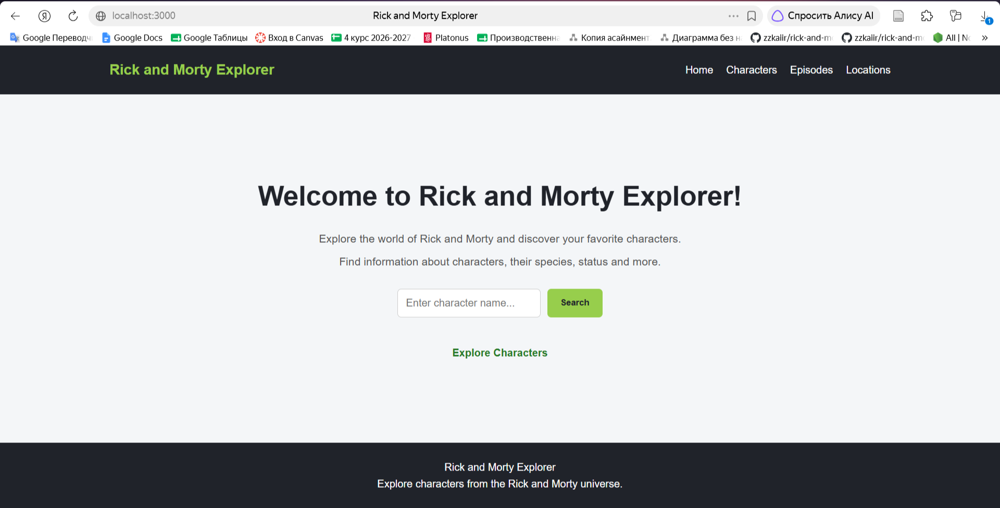
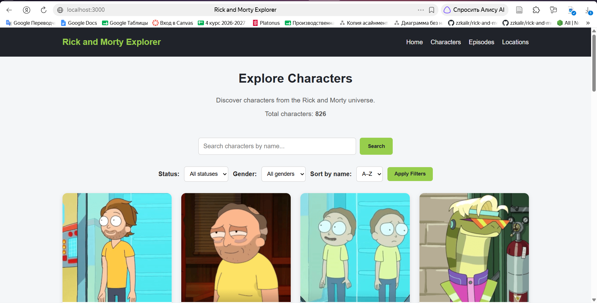
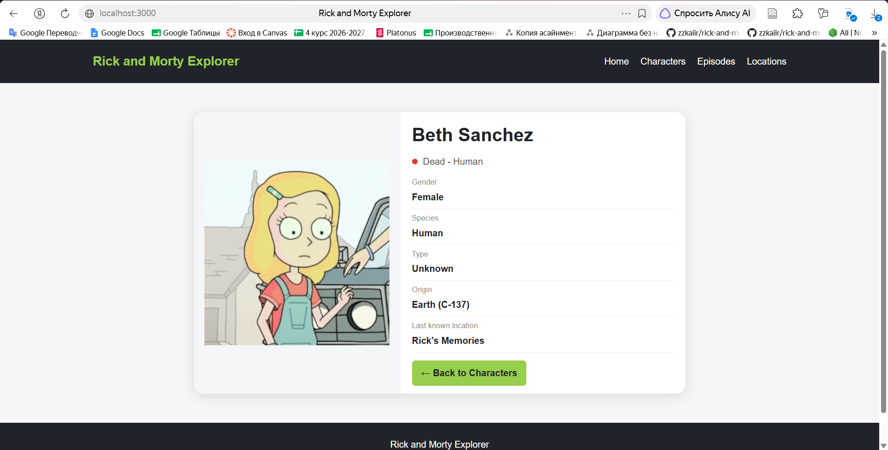

# Rick and Morty Explorer

## Project Description

Rick and Morty Explorer is a web application that allows users to explore information about characters, episodes, and locations from the Rick and Morty series

The application uses Node.js, Express, Axios, and EJS. It gets data from the public Rick and Morty API and displays it in a simple and user-friendly interface.

## API Information

**API Name:** Rick and Morty API

**API Website:** https://rickandmortyapi.com/

The application uses the following API endpoints:

- `/character` – gets character information
- `/character/:id` – gets details about a specific character
- `/episode` – gets episode information
- `/episode/:id` – gets details about a specific episode
- `/location` – gets location information
- `/location/:id` – gets details about a specific location

## Features

- Browse characters from the series
- Search for characters by name
- Filter characters by status and gender
- Sort characters alphabetically
- View detailed character information
- Browse episodes and view episode details
- Browse locations and view location details
- Navigate between related characters, episodes, and locations
- Handle API errors and invalid requests
- Cache API responses to reduce repeated requests

## Application Routes

| Method | Route | Description |
| GET | `/` | Home page |
| GET | `/characters` | Character catalogue |
| GET | `/search` | Search characters |
| GET | `/character/:id` | Character details |
| GET | `/episodes` | Episodes page |
| GET | `/episode/:id` | Episode details |
| GET | `/locations` | Locations page |
| GET | `/location/:id` | Location details |

## Technologies Used

- Node.js
- Express.js
- Axios
- EJS
- HTML
- CSS
- JavaScript
- Rick and Morty API

## Installation and Setup

1. Clone the repository:

   git clone https://github.com/zzkaiir/rick-and-morty-explorer.git

2. Open the project folder:

   cd rick-and-morty-explorer

3. Install dependencies:

   npm install

4. Copy the .env.example file and rename the copy to .env

5. Make sure the .env file contains the correct API configuration

   PORT=3000
   API_BASE_URL=https://rickandmortyapi.com/api

## How to Run

Start the application:

npm start

Open your browser and go to:

http://localhost:3000

## Screenshots
### Home Page

### Characters Page

### Character Details
